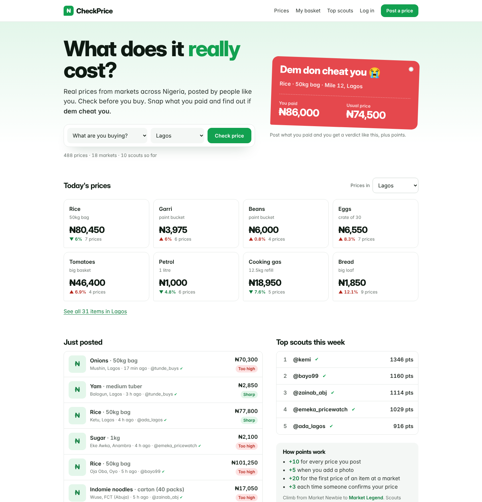
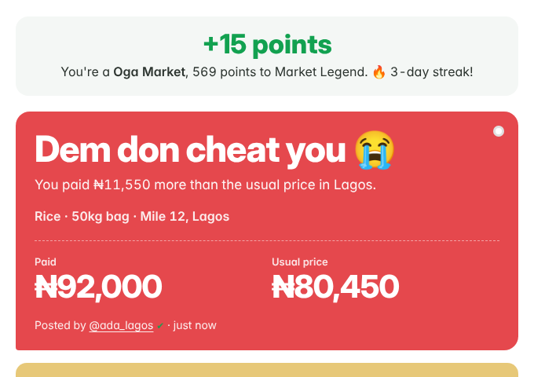

# CheckPrice

**What does it really cost?** Real prices of everyday things in Nigeria, posted by people in markets across all 36 states and the FCT.

Snap what you paid and CheckPrice tells you straight away if it was a good deal, or if **"dem don cheat you"**. Day 5 of **The Daily Ship**. Live at **[checkprice.ejikepius.dev](https://checkprice.ejikepius.dev)**.



## Features

**For shoppers (no account needed)**
- Usual price and **fair range** for 31 everyday items in every state, with a haggling tip: "don't pay more than…"
- **Cheapest markets** near you, prices by state, and a 12-week trend chart
- **My basket**: what your monthly shopping costs today vs three months ago (saved on your device)
- **Price alerts** by email when something gets cheaper
- A **weekly market report**: biggest price moves, cheapest state per item, scouts of the week

**For scouts (free account)**
- Post a price (with an optional photo) and get an instant **verdict**: Sharp 🔥, Fair 👌 or Dem don cheat you 😭
- A shareable **verdict card** (drawn by PHP) for WhatsApp and X
- **Points, ranks and badges**: Market Newbie → Price Hunter → Bargain Boss → Oga Market → Market Legend, streaks, Market Pioneer, Verified Scout
- **Leaderboards** by week and by state
- Confirm or flag other people's prices



## How the numbers stay honest

- Every item has **one fixed unit** (50kg bag, crate of 30, 1 litre…) so prices are comparable
- The "usual price" is the **median** of the last 30 days, so one crazy price can't drag it around; the fair range is the middle half of prices
- Scouts whose prices keep getting confirmed become **Verified** and their prices count **double**
- A price far from normal (over 2.5× or under 1/2.5 of the median) is **held back** until another scout confirms it
- Three flags (more flags than confirmations) **hide** a price and cost the scout points
- Rate limits on posting, sign-up and log-in

## Privacy

Photos are re-saved by the server before they're stored, which removes the hidden data phones add, **including GPS location**. The basket lives only in your browser.

## Run it locally

```bash
CHECKPRICE_URL=http://localhost:8000 php -S localhost:8000 -t public_html public_html/index.php
php tests/run.php        # 26 tests
php bin/alerts.php       # sends price alerts (cron runs this daily in production)
```

## Project structure

| Path | What it is |
|---|---|
| `public_html/index.php` | Router: every page, form and JSON endpoint |
| `public_html/assets/` | CSS, JavaScript (basket, market autocomplete, photo preview), fonts |
| `src/Catalog.php` | The items, units and states |
| `src/Stats.php` | The maths as pure functions: weighted median, fair range, verdicts, outliers, ranks, streaks |
| `src/Prices.php` | Posting, confirming/flagging, summaries, trends, basket, weekly report, alerts |
| `src/Users.php` | Accounts, points ledger, badges, Verified Scouts, leaderboards |
| `src/Photo.php` | Safe photo uploads (type check, rotate, resize, strip metadata) |
| `src/Card.php` | The 1200×630 verdict card, drawn with GD |
| `bin/alerts.php` | Daily price-alert emails |
| `tests/run.php` | Tests |

Deploying: see [DEPLOY.md](DEPLOY.md).

Built by **Ejike Pius** ([@ejike_pius](https://x.com/ejike_pius), [ejikepius.dev](https://ejikepius.dev)). MIT licence.
